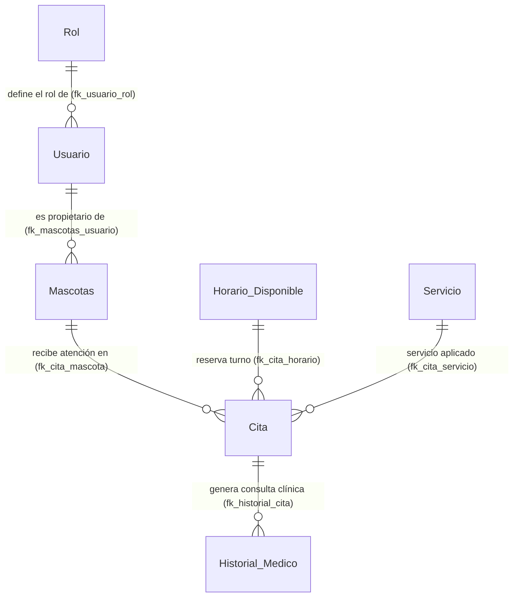

# 🐾 Clínica Veterinaria "Amor Animal"
### Sistema Integral de Gestión Veterinaria (FastAPI + Tailwind CSS + MySQL XAMPP)

Plataforma profesional de software médico desarrollada en **Python (FastAPI)**, **Tailwind CSS**, **HTML5/JavaScript** y **MySQL (XAMPP)** para la administración completa de pacientes, propietarios, catálogo de servicios, control de agenda/citas e historial clínico veterinario.

---

## 🌟 Características Principales del Sistema

- **Arquitectura Web Moderna:** Interfaz estilo SaaS médico profesional (Tailwind CSS, FontAwesome 6, Chart.js y SweetAlert2).
- **Cero recargas de página (SPA):** Respuestas instantáneas mediante llamadas API REST sin el parpadeo de re-ejecución total de Streamlit.
- **Conexión Directa a MySQL (XAMPP):** Manejo transaccional estricto con `commit` y `rollback` en cada operación.
- **Integridad Referencial Estricta:** Relación y validación foránea entre las 7 tablas de la clínica (`Rol` ➔ `Usuario` ➔ `Mascotas`, `Servicio`, `Horario_Disponible` ➔ `Cita` ➔ `Historial_Medico`).
- **Control Atómico de Turnos:** Al agendar una cita, el horario se bloquea automáticamente como `Ocupado`. Si la cita se cancela, el horario se libera a `Disponible`.
- **Expediente Clínico & Carnet Digital:** Visualización de ficha técnica de cada paciente, registro de signos vitales (peso y temperatura), diagnósticos, tratamientos y recetas listas para imprimir.
- **Documentación Interactiva Swagger:** Documentación viva y probador de endpoints integrado en `/docs`.

---

## 🗄️ Esquema Relacional de la Base de Datos



### Detalle de Tablas y Llaves Foráneas:
1. **`Rol`**: `id_rol` (PK), `nombre_rol` ('Administrador', 'Veterinario', 'Propietario').
2. **`Usuario`**: `id_usuario` (PK), `nombre`, `telefono`, `correo` (UNIQUE), `contrasena`, `id_rol` (FK a `Rol.id_rol`).
3. **`Mascotas`**: `id_mascota` (PK), `nombre_mascota`, `especie`, `raza`, `edad_aprox`, `peso`, `id_usuario` (FK a `Usuario.id_usuario` ON DELETE CASCADE).
4. **`Servicio`**: `id_servicio` (PK), `nombre_servicio`, `descripcion`, `costo`.
5. **`Horario_Disponible`**: `id_horario` (PK), `fecha`, `hora_inicio`, `estado_horario` ('Disponible', 'Ocupado').
6. **`Cita`**: `id_cita` (PK), `id_mascota` (FK), `id_horario` (FK), `id_servicio` (FK), `estado_cita` ('Programada', 'Confirmada', 'Atendida', 'Cancelada').
7. **`Historial_Medico`**: `id_historial` (PK), `id_cita` (FK), `peso_actual`, `temperatura`, `sintomas`, `diagnostico`, `tratamiento`.

---

## 🚀 Guía de Instalación y Ejecución Local

Cualquier persona que clone este repositorio puede ejecutar el sistema en su propia computadora siguiendo estos pasos:

### 1. Prerrequisitos
- **Python 3.10 o superior**
- **XAMPP** (con el servicio **MySQL** activo en el puerto `3306`)

### 2. Clonar el Repositorio e Instalar Dependencias
```bash
git clone https://github.com/patocalipto/amor-animal-clinic-app.git
cd amor-animal-clinic-app
pip install -r requirements.txt
```

### 3. Iniciar el Servidor de Base de Datos (MySQL)
1. Abre el panel de control de **XAMPP**.
2. Presiona **Start** en el módulo **MySQL** (verificando que esté en color verde en el puerto `3306`).

### 4. Ejecutar la Aplicación
Puedes iniciar la aplicación con cualquiera de las dos formas:
- **Por Terminal:**
  ```bash
  python main.py
  ```
- **En Windows:** Haz doble clic en el archivo `run_app.bat`.

### 5. Inicializar la Base de Datos
Al abrir el sistema por primera vez en `http://localhost:8000`:
- Ve a la sección **⚙️ Diagnóstico DB** y presiona el botón:  
  > **⚡ Inicializar / Cargar Datos Semilla**  
  
El sistema creará automáticamente la base de datos `clinica_amor_animal`, las 7 tablas con sus restricciones de llaves foráneas y los datos iniciales de prueba. *(También se incluye el archivo `database.sql` por si se prefiere importar manualmente desde phpMyAdmin).*

### 6. Acceso en el Navegador
- **Sistema Web Principal:** `http://localhost:8000`
- **Documentación Interactiva Swagger (API):** `http://localhost:8000/docs`

---

## 🧭 Recorrido por los Módulos del Sistema

1. **📊 Dashboard General**: Métricas en tiempo real, gráfica interactiva de distribución por especies con Chart.js y tabla de citas en agenda.
2. **👥 Propietarios y Roles**: Directorio interactivo con búsqueda en tiempo real, filtro por rol y modal para registrar nuevos usuarios con validación de correo único.
3. **🐶 Pacientes (Mascotas)**: Grid visual de tarjetas clínicas con filtros rápidos por especie (Perro, Gato, Ave, Conejo), modal de registro vinculado al propietario y carnet digital imprimible.
4. **📅 Citas y Agenda**: Asignación atómica de citas a horarios disponibles, cambio de estados (Confirmar, Atender, Cancelar) y modal para abrir nuevas franjas horarias.
5. **🩺 Médico e Historial Clínico**: Módulo clínico exclusivo para captura de constantes vitales, diagnóstico y tratamiento con actualización automática del peso del paciente y de la cita a `'Atendida'`.
6. **🏷️ Servicios Clínicos**: Catálogo de procedimientos con precios y formulario para dar de alta nuevos servicios.
7. **📋 Reporte Maestro (JOIN)**: Vista consolidada de relaciones y botón para exportar a CSV.
8. **⚙️ Diagnóstico DB**: Monitor en vivo de registros en las 7 tablas y botón para reinicializar datos semilla de prueba.
